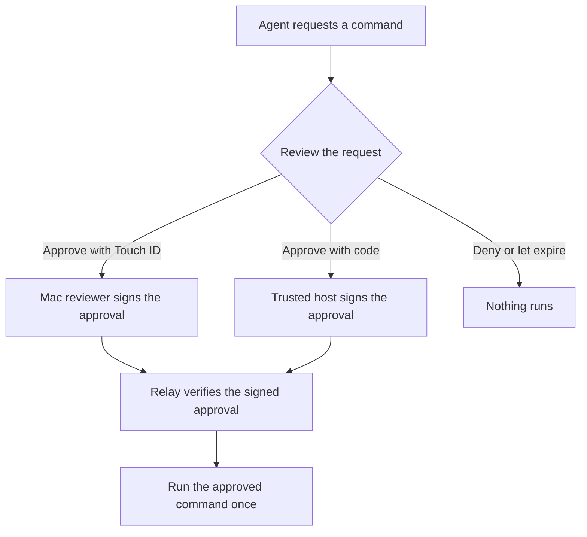
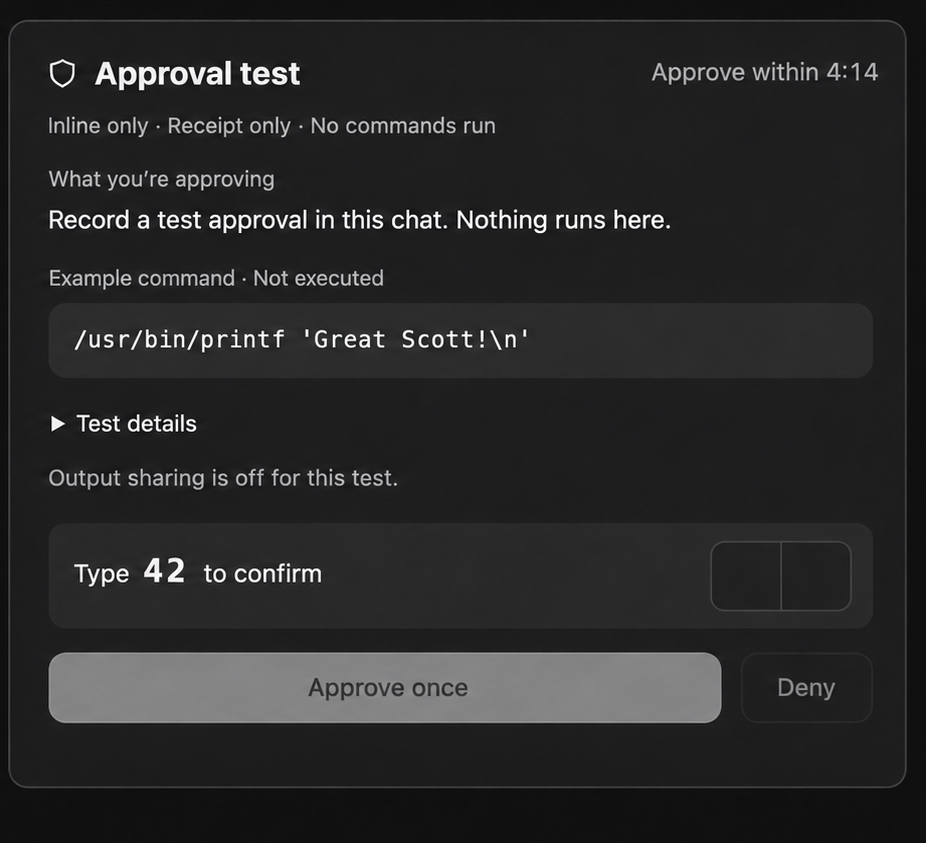
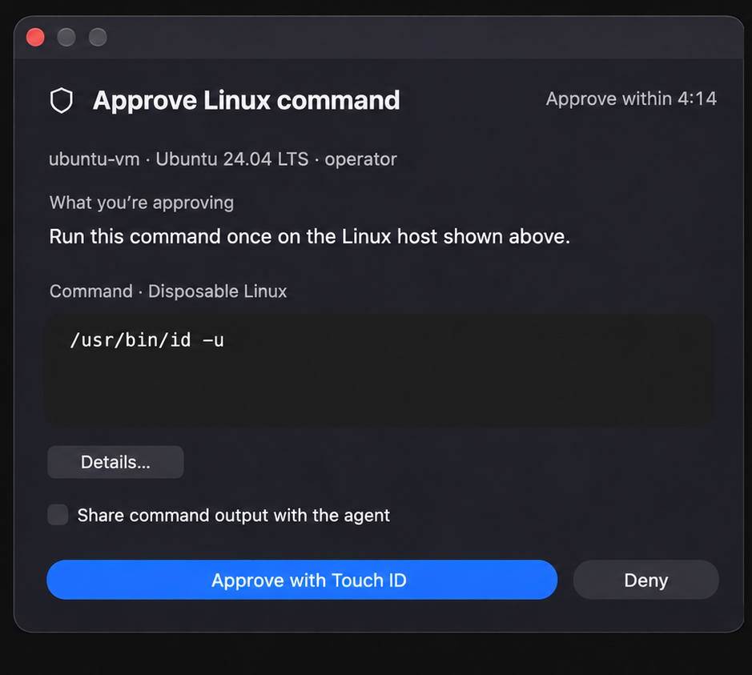

# sudo-relay

## What is this?

Let an agent ask to run a specific command with elevated privileges. You see what it wants to run, where it will run, and which account it targets. You can approve that request once, deny it, or let it expire.

Say an agent is troubleshooting a Linux VM and reaches a step that needs root. You can approve that one step without giving the agent your sudo password or opening a root shell for it. You also choose whether the agent gets the command output.

## How it works


Your workstation is where you run the MCP client and review requests. The relay runs on the machine that will execute the command. For a local setup, that can be the same machine.

### Approve with a two-digit code

When the agent asks to run a command, the approval card appears right in the chat. Check the command and type the two digits shown on the card. If your chat host has a trusted signing adapter, it signs the approval so the relay can run the command. The [receipt-only host](security-lab/approval-host/README.md) in this screenshot records the decision without running anything.



### Approve with Touch ID

The request opens in a separate window on your Mac. You can check the command and the Linux machine it will run on before using Touch ID. Your fingerprint unlocks the signing step, and the Linux relay verifies the signed approval before running the command.



### What both paths share

Either way, you get to see the command and decide whether the agent should get its output. Approval applies to that one request. If you deny it or let it expire, the command stays unexecuted.

### Which should you use?

Code approval is easier to fit into an existing chat setup. It can work on macOS or Linux with a compatible host, and there’s no Mac app to build or sign. The tradeoff is that the digits are right there on the card. They help you confirm the request, but the host still has to make sure the approval came from you.

Touch ID gives you a stronger check that a person approved the request because the fingerprint prompt happens outside the chat client. It takes more to set up: you need a Mac with Touch ID, an Apple Developer signing key to sign the reviewer app, and a paired Linux relay. An isolated Apple Developer Personal Team worked for the preview.

## Understanding the risks of using this

sudo-relay controls the commands it runs. If an agent already has root access through sudo, Docker, SSH, or another route, that access still exists. A command you approve as root can change the machine or expose data.

**What's been verified**

- **Approval:** Touch ID in Codex and two-digit confirmation with an MCP software signer both led to execution of the approved command. Code entry alone cannot authorize execution.
- **No execution:** Denied, cancelled, and expired requests stayed unexecuted. Replayed approvals were rejected, including after a broker restart.
- **Clean removal:** Ubuntu VM setup and uninstall passed, with the original sudo and PAM files intact.

**What remains unverified**

- Codex is the only chat client verified end to end. Approval in Claude Code, Pi, Cursor, and other MCP clients remains untested. A client may be able to request a command without supporting the approval card or a trusted signer.
- How well the approval boundary holds up across signing setups and real deployments. The project hasn't had an independent security audit.
- How the relay behaves under some failures, including power loss and restoring an older VM snapshot. An approval may become usable again after rollback.

See the [disclaimer](#disclaimer) and the [full security notes](docs/source-alpha-security.md) for the evidence and open questions. If you're evaluating the setup, use a disposable machine and throwaway credentials.

## Installing (build from source)

The commands below download the v0.1.0-alpha.1 source archive, verify its SHA-256, and build the broker and approval UI. Service installation and Mac signing are separate steps.

### macOS

1. Install the Xcode Command Line Tools if needed: `xcode-select --install`.
2. Install Rust and Node.js 24 with Homebrew: `brew install rust node@24 wget`.
3. Add Node.js 24 to your path: `export PATH="$(brew --prefix node@24)/bin:$PATH"`.
4. Run `node --version` and confirm it reports `v24.x`.
5. Download and build: `wget --https-only -O build.sh https://github.com/brandonscript/sudo-relay/releases/download/v0.1.0-alpha.1/build.sh && sh build.sh https://github.com/brandonscript/sudo-relay/releases/download/v0.1.0-alpha.1/sudo-relay-v0.1.0-alpha.1-source.zip "$(wget --https-only -qO- https://github.com/brandonscript/sudo-relay/releases/download/v0.1.0-alpha.1/sudo-relay-v0.1.0-alpha.1-source.sha256)"`.

### Linux

1. Install wget, unzip, and a C compiler with your package manager.
2. Install the stable Rust toolchain with [Rustup](https://rustup.rs/).
3. Install [nvm](https://github.com/nvm-sh/nvm#installing-and-updating), then run `nvm install 24`.
4. Run `node --version` and confirm it reports `v24.x`.
5. Download and build: `wget --https-only -O build.sh https://github.com/brandonscript/sudo-relay/releases/download/v0.1.0-alpha.1/build.sh && sh build.sh https://github.com/brandonscript/sudo-relay/releases/download/v0.1.0-alpha.1/sudo-relay-v0.1.0-alpha.1-source.zip "$(wget --https-only -qO- https://github.com/brandonscript/sudo-relay/releases/download/v0.1.0-alpha.1/sudo-relay-v0.1.0-alpha.1-source.sha256)"`.

[build.sh](build.sh) verifies the ZIP before extracting it and prints the path to the built checkout. If you already have the source, run `sh build.sh` from the checkout.

## Try it without root first

This is a quick way to see how a request gets from your chat to the approval card. The broker runs as your own user, and the reference host displays the card without signing an approval.

1. Open a terminal in the source checkout and start a broker under your own account. Keep track of the directory assigned to `SUDO_RELAY_SANDBOX`. You’ll need it in the next terminal.
   ```sh
   SUDO_RELAY_SANDBOX=$(mktemp -d)
   chmod 700 "$SUDO_RELAY_SANDBOX"
   printf 'SUDO_RELAY_SANDBOX=%s\n' "$SUDO_RELAY_SANDBOX"
   target/debug/broker --development init \
     "$SUDO_RELAY_SANDBOX/config.json" \
     "$SUDO_RELAY_SANDBOX/state" \
     "$SUDO_RELAY_SANDBOX/run/broker.sock" \
     "$(id -u)" "$(id -u)" "$(id -g)"
   target/debug/broker --development serve "$SUDO_RELAY_SANDBOX/config.json"
   ```
2. Leave the broker running. Open a second terminal in the checkout and set `SUDO_RELAY_SANDBOX` to the directory from step 1. Then create an approval key.
   ```sh
   cd ui
   npm run keygen -- "$SUDO_RELAY_SANDBOX/approver.pem"
   ```
3. Go back to the repository root and replace `PUBLIC_KEY_HEX` with the public key printed in step 2. Keep the private PEM file on your machine.
   ```sh
   target/debug/broker --development pair "$SUDO_RELAY_SANDBOX/config.json" demo PUBLIC_KEY_HEX
   ```
4. Add the MCP server to your chat client. Use absolute paths for the server binary, the socket under `SUDO_RELAY_SANDBOX`, and the built card.
   ```json
   {
     "mcpServers": {
       "sudo-relay": {
         "command": "/absolute/path/target/debug/mcp-server",
         "args": ["/absolute/path/to/run/broker.sock", "/absolute/path/ui/dist/card.html"]
       }
     }
   }
   ```
   For several local instances, use a separate named connection and socket for each. See the [multiple-target guide](docs/multiple-targets.md).

5. In chat, ask your agent to request `/usr/bin/printf` with `hello` as a separate argument. Copy the request ID from the tool result.

6. In the second terminal, go into `ui` and start the reference host.
   ```sh
   BROKER_SOCKET="$SUDO_RELAY_SANDBOX/run/broker.sock" npm run demo
   ```
7. Open the URL printed in the terminal and paste the request ID. The card shows the command the agent asked to run. The request stays pending unless you cancel it or it expires. When finished, stop the reference host and broker with Ctrl-C, then remove only the temporary directory printed in step 1.

## Try it in a disposable test environment

Use this Docker environment to exercise signed approvals, execution, and rejection checks with separate agent and approver accounts. It starts the Linux broker in production mode and generates temporary signing keys inside the container. The tests drive approvals programmatically; there is no chat card or Touch ID window in this walkthrough.

1. Install Docker Engine and Docker Compose, then check that the engine is running. On macOS, Docker also needs a running Linux VM, such as Colima or Docker Desktop.
   ```sh
   docker info
   docker compose version
   ```
2. Open a terminal in the source checkout. Give this run a unique project name and define a shortcut for the commands below. Keep using the same terminal through cleanup.
   ```sh
   SUDO_RELAY_FIXTURE="sudo-relay-$(date +%Y%m%d%H%M%S)-$$"
   fixture() {
     docker compose -p "$SUDO_RELAY_FIXTURE" \
       -f security-lab/fixture/compose.yaml "$@"
   }
   fixture up --build -d --wait
   ```
   The first build downloads dependencies and compiles Rust. The container is ready when this command succeeds. Its runtime has no network access, host mounts, or published ports.
3. Inspect the generated configuration, then run the agent checks. These confirm that unapproved requests stay pending, cancellation prevents execution, and the agent cannot read or change protected files or approve its own request.
   ```sh
   fixture exec -T sandbox cat /lab/fixture.json
   fixture exec -T --user 10001:10001 sandbox \
     python /fixture/test_smoke.py
   ```
4. Run the signed approval, replay, and output-sharing checks. This controller switches between the container's agent and approver accounts, signs approvals with its temporary key, and executes commands inside the container. It checks that approved commands run once, altered or reused approvals are rejected, and output is shared only when approved. Run it after step 3 finishes.
   ```sh
   fixture exec -T sandbox python /fixture/test_replay.py
   ```
   Both suites should finish with `OK` and exit successfully. If either fails, inspect the broker logs with `fixture logs sandbox` before cleaning up.
5. Remove the environment when finished, including after a failed check.
   ```sh
   fixture down --volumes --remove-orphans
   ```
   Removing the container discards its keys, ledger, and runtime files. Docker retains the build image and cache for later runs.

See the [fixture guide](security-lab/fixture/README.md) for enrollment checks, account identities, isolation settings, and the limits of these tests.

## Use it with your chat client

The verified end-to-end setup is Codex with a Touch ID Mac approving commands on an Ubuntu 24.04 VM hosted by Lima on that Mac. It runs `/usr/bin/id -u` as root. The current installer requires a VM, and the relay accepts only that command. Support for arbitrary commands and physical Linux targets still needs implementation and verification.

### Set up Touch ID approval

1. [Build the source](#installing-build-from-source) on your Mac and Linux target. The [Touch ID setup guide](preview/README.md#what-you-need) lists the additional dependencies and walks through the platform-specific build and setup commands.
2. Install the Linux relay as the account whose sudo permission will authorize execution. Follow [Build and install on Linux](preview/README.md#build-and-install-on-linux), then [prepare the transport identities](preview/README.md#prepare-the-macs-transport-identities). Keep the printed machine identity and SSH host fingerprint so you can compare them during Mac setup.
3. Prepare the protected Mac reviewer, then [pair its public key](preview/README.md#pair-the-approving-key) with the Linux relay. This needs a Mac with Touch ID and an Apple Developer signing identity. The isolated Personal Team setup passed; signing and enrollment with a different team and bundle ID still need verification. The [reviewer signing and enrollment notes](preview/README.md#mac-reviewer-signing-and-enrollment) describe the existing build and its setup dependencies. A self-service signing path for a new team is still outstanding. Keep the private signing key outside the agent's reach.
4. [Install the Mac target](preview/README.md#install-the-mac-target), checking the machine, account, and key fingerprints against the Linux setup output. Add the exact MCP command printed by setup to Codex, then restart that connection so it loads the configuration.
5. Open a chat with the connection enabled and ask the agent to request `/usr/bin/id -u` on your Ubuntu VM using sudo-relay. Review the target and command in the native Mac window. Choose whether to share the output, then approve with Touch ID, deny the request, or let it expire.
6. Ask the agent to check `execution_status`. An approved, successful run with output sharing enabled reports `0`. If you denied the request or it expired, the command stays unexecuted. See [Revoke, inspect and remove](preview/README.md#revoke-inspect-and-remove) when you want to withdraw access or uninstall.

### Use inline code approval

Code approval has passed MCP integration checks with a software signer. Using it in your chat requires a host that displays the approval card and provides a trusted signing adapter. A ready-to-use adapter for general chat clients is still outstanding.

1. Connect the MCP client to your relay and integrate a trusted host adapter using the [host approval design](docs/chat-approval-design.md). The adapter must obtain your approval and keep its signing key outside the agent's control. Adding the MCP connection alone does not complete this setup.
2. Ask the agent to request a command allowed by your setup. Review the inline card, choose whether to share the output, and enter the two-digit code. The host signs the decision, and the relay verifies it before executing the command once.
3. Ask the agent to check `execution_status` for the result. The included [inline receipt host](security-lab/approval-host/README.md) can exercise approval decisions, but it records receipts only and cannot execute commands. Claude Code, Pi, Cursor, and other clients still need end-to-end verification.

## Verification results

Client checks have case IDs scoped to the AI client, its major version, and the platforms involved. The [verification case registry](docs/verification-cases.md) maps IDs to reproduction steps, expected results, and recorded evidence. Use these IDs when reporting a regression or suspected vulnerability.

Results below describe the recorded runs. Build and environment details, procedures, and coverage limits are in the linked reports and registry. The historical Codex reports omit its version, so those IDs use `unknown` until the version can be established.

### Codex

| Case ID | Check | Verified behavior | Recorded result | Runbook & results |
|---|---|---|---|---|
| `codex-unknown-macos-ubuntu-touchid-001` | Approve once | Status is complete, exit code is 0, stdout is `0\n`, and the audit records exactly one consumption and launch. | ✅ Pass | [Runbook](docs/test-cases/codex-unknown-macos-ubuntu-touchid-001.md) · [Results](docs/developer-preview-milestone.md#human-approved-actual-mcp-execution--november-13) |
| `codex-unknown-macos-ubuntu-close-001` | Close after remote cancellation | Window closes quietly, request stays cancelled, and execution outcome is null. | ✅ Pass | [Runbook](docs/test-cases/codex-unknown-macos-ubuntu-close-001.md) · [Results](docs/native-quiet-close.md#november-18-live-result) |
| `codex-unknown-macos-ubuntu-close-002` | Deny after remote cancellation | Window closes quietly, request stays cancelled, and execution outcome is null. | ✅ Pass | [Runbook](docs/test-cases/codex-unknown-macos-ubuntu-close-002.md) · [Results](docs/native-quiet-close.md#november-18-live-result) |
| `codex-unknown-macos-ubuntu-close-003` | Close while pending | Window closes quietly, request becomes cancelled, and execution outcome is null. | ✅ Pass | [Runbook](docs/test-cases/codex-unknown-macos-ubuntu-close-003.md) · [Results](docs/native-quiet-close.md#november-18-live-result) |
| `codex-unknown-macos-ubuntu-close-004` | Close after idle expiry | Window closes quietly, request remains expired, and execution outcome is null. | ✅ Pass | [Runbook](docs/test-cases/codex-unknown-macos-ubuntu-close-004.md) · [Results](docs/native-quiet-close.md#november-18-live-result) |

### Automated MCP integration

| Case ID | Check | Verified behavior | Recorded result | Runbook & results |
|---|---|---|---|---|
| `mcp-linux-software-001` | Approval and peer identity | Unprivileged submissions fail. The approver succeeds and MCP receives UID 0 output when sharing is enabled. | ✅ Pass | [Runbook](docs/test-cases/mcp-linux-software-001.md) · [Results](docs/mcp-sudo-milestone.md#acceptance-tests) |
| `mcp-linux-software-002` | Signed output choice | Changed decisions fail. Unshared streams are empty. Shared output obeys the cap and reports truncation. | ✅ Pass | [Runbook](docs/test-cases/mcp-linux-software-002.md) · [Results](docs/mcp-sudo-milestone.md#acceptance-tests) |
| `mcp-linux-software-003` | Proof substitution | Substituted proofs create no execution marker. | ✅ Pass | [Runbook](docs/test-cases/mcp-linux-software-003.md) · [Results](docs/mcp-sudo-milestone.md#acceptance-tests) |
| `mcp-linux-software-004` | Concurrent approval | Exactly one succeeds and the launch count increases by one. | ✅ Pass | [Runbook](docs/test-cases/mcp-linux-software-004.md) · [Results](docs/mcp-sudo-milestone.md#acceptance-tests) |
| `mcp-linux-software-005` | Cancellation and expiry | Neither request launches or produces an execution outcome. | ✅ Pass | [Runbook](docs/test-cases/mcp-linux-software-005.md) · [Results](docs/mcp-sudo-milestone.md#acceptance-tests) |
| `mcp-linux-software-006` | Revocation and NOPASSWD | Revoked authority prevents launch. NOPASSWD still requires an independent signed approval. | ✅ Pass | [Runbook](docs/test-cases/mcp-linux-software-006.md) · [Results](docs/mcp-sudo-milestone.md#acceptance-tests) |
| `mcp-linux-software-007` | Disconnect and reconnect | Execution completes once and replay causes no additional launch. | ✅ Pass | [Runbook](docs/test-cases/mcp-linux-software-007.md) · [Results](docs/mcp-sudo-milestone.md#acceptance-tests) |
| `mcp-linux-software-008` | Loss after consumption | State is uncertain, the marker is absent, and the approval cannot be reused. | ✅ Pass | [Runbook](docs/test-cases/mcp-linux-software-008.md) · [Results](docs/mcp-sudo-milestone.md#acceptance-tests) |

### Ubuntu VM lifecycle

| Case ID | Check | Verified behavior | Recorded result | Runbook & results |
|---|---|---|---|---|
| `vm-ubuntu-lifecycle-001` | Install and identify sponsor | Installer binds the invoking sponsor, creates separate role accounts, and starts the protected loopback channel. | ✅ Pass | [Runbook](docs/test-cases/vm-ubuntu-lifecycle-001.md) · [Results](docs/developer-preview-milestone.md#clean-installation-and-signed-reviewer-checkpoint--november-13) |
| `vm-ubuntu-lifecycle-002` | Restart and replay | Completed/consumed state survives, replay fails, and transient output is unavailable. | ✅ Pass | [Runbook](docs/test-cases/vm-ubuntu-lifecycle-002.md) · [Results](docs/developer-preview-milestone.md) |
| `vm-ubuntu-lifecycle-003` | Revoke and remove | Revocation prevents execution. Removal cleans relay state/services/accounts/policy, original files match, and ordinary sudo works. | ✅ Pass | [Runbook](docs/test-cases/vm-ubuntu-lifecycle-003.md) · [Results](docs/developer-preview-milestone.md) |

Have a test case to add? Open a pull request with a proposed runbook, even if it is still unverified. Better yet, include reproducible evidence from your own run, with the client and OS versions, source revision, expected result, and observed result. Use the [case registry](docs/verification-cases.md) for IDs and evidence details. Report suspected vulnerabilities privately through [SECURITY.md](SECURITY.md).

## What still needs checking

- **Human approval in chat.** In the earlier receipt experiment, an agent operating the expanded chat card could record an approval receipt. Nothing executed, but this demonstrated that the card alone could not establish who approved. The remaining check is whether each host's signing adapter reliably requires a human decision and keeps the key outside the agent's reach. See the [chat approval design](docs/chat-approval-design.md) and [receipt experiment](security-lab/approval-host/README.md).
- **Signing with your own team.** The Mac signing kit expects the lab's Apple Developer team and bundle ID. Signing and enrolling with a different team and bundle ID still need verification.
- **Failure and recovery.** Power loss, VM snapshot rollback, account/UID reuse, and some revocation races remain open. A rollback could make an old approval usable again. See the [full security notes](docs/source-alpha-security.md).
- **Roadmap and larger improvements**
  - Verify Claude Code, Pi, Cursor, and other MCP clients, including their approval UI and signer boundaries.
  - Build a portable inline signing adapter and a Linux desktop reviewer, with protected key storage and human authentication.
  - Extend passkey approval from receipt recording to signed command execution.
  - Explore iOS approval apps and web approval apps with authenticated device pairing and a clear display of the target and command.
  - Support broader command policies and physical Linux targets, then verify setup, revocation, and removal on those deployments.
  - Simplify signing, installation, and upgrades so setup does not depend on the original team's configuration.

## Disclaimer

Use sudo-relay at your own risk. It runs commands with elevated privileges, and an approved command can expose data, damage the system, or establish persistent access. The project is experimental and has not had an independent security audit. Passing cases establish the behavior observed in those environments; other clients, configurations, and failure conditions still need checking.

Keep the approving key and human authentication outside the agent's control. Production mode requires different agent and approver user IDs, and the signer still needs its own protection. Review the [security notes](docs/source-alpha-security.md), [pre-trial review](docs/pre-trial-review.md), and [MIT license](LICENSE) before granting access.

## Limits

### Supported setup

The verified interactive setup uses Codex, a Touch ID Mac, and an Ubuntu VM hosted by Lima. The preview installer requires a VM and accepts only `/usr/bin/id -u`. Automated Linux checks also exercise signed code approval, but a general-purpose inline adapter, Linux reviewer, and passkey execution path are still outstanding.

### What an approval permits

Approval authorizes one exact request. The relay binds the signature to the target, command, and output-sharing choice. A root command can still create lasting access or change files that affect later operations. Existing sudo, Docker, SSH, and other administrative access also remain available.

The wider protocol supports scripts, but freezing script text does not freeze the files, dependencies, or network responses it uses. That broader protocol support does not expand the preview's command allowlist.

### Output, storage, and recovery

| Area | Behavior and consequence |
|---|---|
| Output sharing | Each approval includes your sharing choice. With sharing off, the agent receives status information such as the exit code, but stdout and stderr are empty. The card remembers your last preference, with sharing initially off. |
| Output retention | Shared output is held in memory, capped at 1 MiB per stream for the most recent 32 completions. A restart clears it. System administrator logging, including sudo I/O logs where enabled, can retain output separately. |
| Request ledger | Commands and scripts are stored in the private on-disk ledger. Keep secrets out of arguments, scripts, and explanations. At 10,000 records, the broker refuses new requests until an administrator archives and rotates the ledger. |
| Expiry and timeouts | The approval window and execution timeout are separate. Approval defaults to five minutes. The Touch ID preview bounds execution at five seconds. See the [protocol](docs/protocol.md#local-transport) for configuration details. |
| Restarts and disconnects | Restart cancels pending requests and preserves consumed/completed state, while transient results are lost. A disconnect after approval does not undo execution. If confirmation is lost, inspect status and the audit before requesting the command again. |

See the [security model](docs/security.md) and [protocol](docs/protocol.md) for the full behavior and remaining constraints.

## Feedback

If setup, approval, or removal gives you trouble, describe what you were trying to do, where you got stuck, and what showed up in chat or the review window. Include your OS and client version. See [CONTRIBUTING.md](CONTRIBUTING.md) to share feedback, or [SECURITY.md](SECURITY.md) to report a suspected vulnerability privately.

## License

[MIT](LICENSE).
